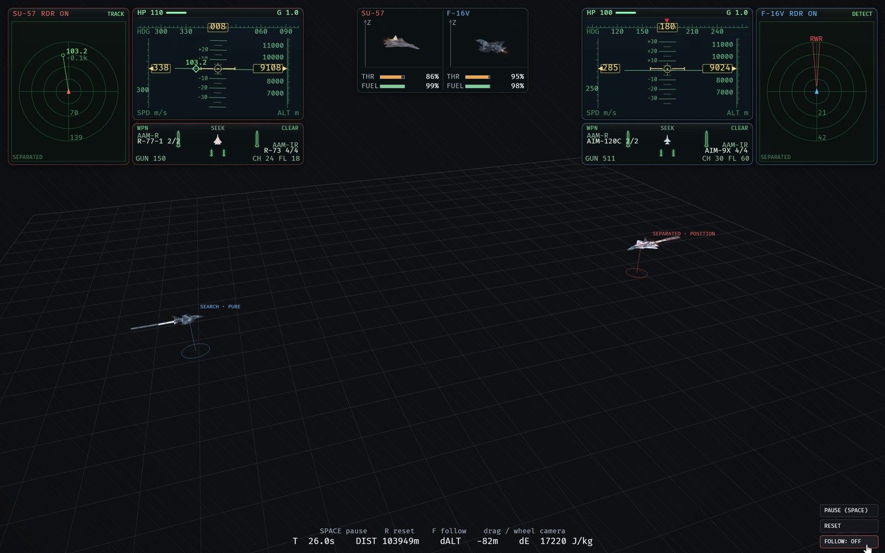
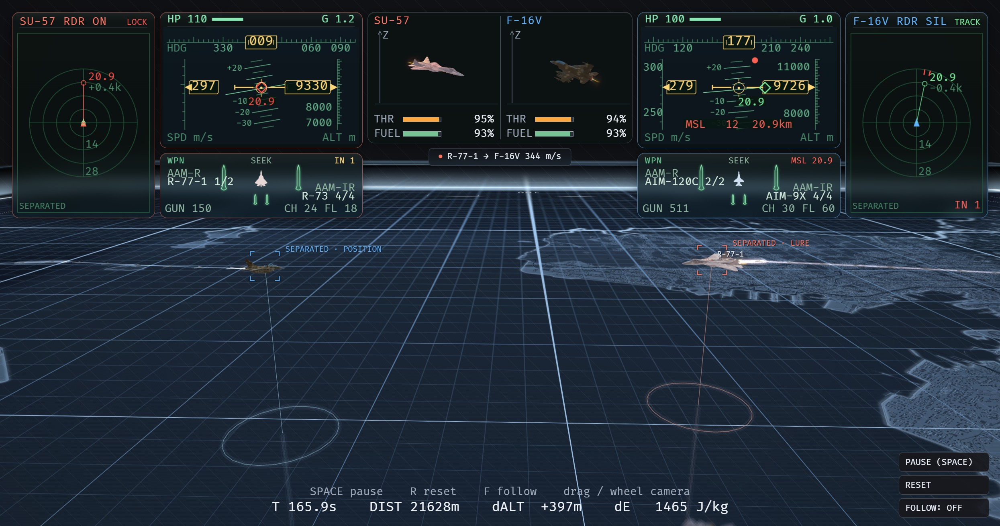
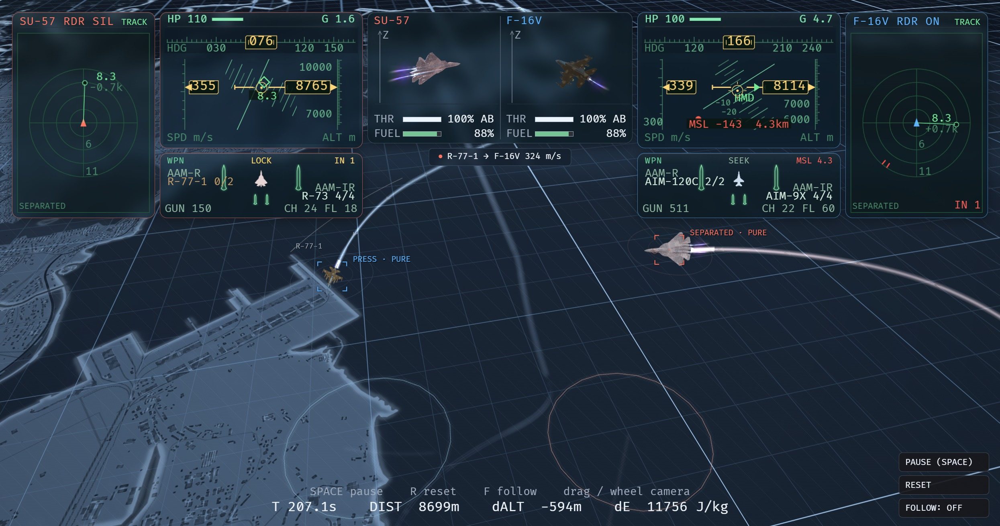
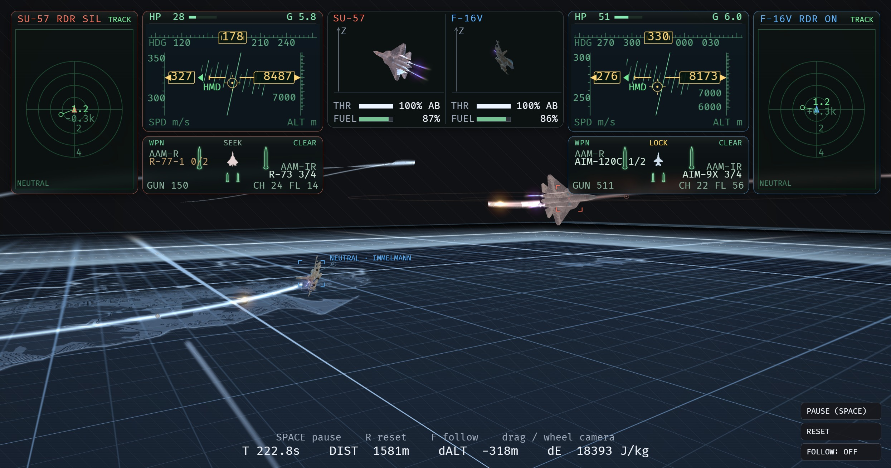
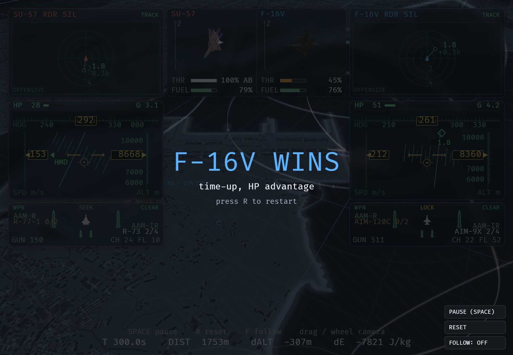

# 空战狗斗模拟器

基于 Python 的 1v1 空战对抗模拟：6DOF / 3DOF / 2DOF 动力学内核 + 四层战术 Agent + three.js 浏览器 3D 可视化。
目标是研究**机体性能参数如何影响超视距（BVR）与近距格斗（WVR）的战术选择**，而不是做一个飞行模拟器。

唯一可视化入口是浏览器里的 three.js 观战端（实时 3D、可交互相机、1080p 采集）；主程序本身只用终端输出过程与结果。

当前版本：**1.1.1**（构建方式见[构建发行版](#构建发行版)）。

### 当前状态

- **机型库**：Su-57、F-16V Block 70、J-20A、J-20S、F-15C、F-15E、F-15EX，参数与挂载见[机型参数与武器挂载](docs/机型参数与武器挂载.md)。
- **气动**：J-20 按全动鸭翼增升建模（`canard_cl_bonus` / `canard_alpha_max_deg` / `canard_stall_shift_deg`），Su-57 按三元矢量喷口建模；两者都可进入过失速指令（COBRA、克沃丘尔钟摆）。
- **RCS 标定**：正面 RCS 已统一到同一数量级 —— F-22 0.001 m²、J-20A 0.002 m²、J-20S 0.003 m²（−30 / −27 / −25.2 dBsm），F-15 家族 5–6 m²、F-16V 1.2 m²。
- **武器**：PL-10 / PL-15 / PL-21 已入库；PL-15 按**双脉冲固体发动机**建模（`boost 36 kN×3 s → 滑翔 18 s → 第二脉冲 14 kN×6 s`，总冲 192 kN·s）；J-20A/S 已装 GSh-30-1 型 30 mm 机炮（150 发，工程估计）。
- **战术**：垂直机动（殷麦曼/筋斗）增加了过载与动能准入、翼平进入段和 1.65 倍失速的提前改出；Su-57 / J-20 这类带矢量喷口或全动鸭翼的机型，过载门限按 0.70 折减、能量裕度从 0.65 放宽到 0.90。具备超机动能力的 6DOF 机型在失速时转入 COBRA，否则卸载推杆，不再出现“失速后持续盘旋滑落”。
- **最新 BVR 对照**（`bvr_1v1`，20 组 seed）：F-15EX 12 : J-20A 8（击落 4 : 5），详见[机型参数与武器挂载 §6](docs/机型参数与武器挂载.md)。
- **测试**：`PYTEST_DISABLE_PLUGIN_AUTOLOAD=1 python -m pytest tests` 60 项全部通过。


> **特别声明：本仓库中所有机体、武器、传感器与 RCS 参数均来源于互联网公开资料**（含厂商公开手册、航展展板、政府报告、维基百科与航空媒体报道），仅用于教学、对比实验与战术研究。所有数值均为公开资料的整理、换算或工程估计，不代表任何国家的官方数据，也不保证其准确性、完整性与时效性；请勿用于作战评估、装备论证或任何实际军事用途。RCS 等敏感参数在不同来源中可能使用不同单位（m² 与 dBsm，换算关系为 `dBsm = 10·log₁₀(m²)`），引用时请以原始来源为准。



## 功能

### 动力学内核

- 默认 6DOF 刚体，可一键切到 3DOF / 2DOF 做对照实验；物理步进 120 Hz，Agent 决策 10 Hz。
- ISA 标准大气（0–32 km），密度同时作用于升力、诱导阻力与推力；推力按 `(ρ/ρ₀)^n` 衰减（指数按机型标定：Su-57 0.65、F-16V 0.90），再叠加冲压恢复、高空推力悬崖与安装损失；阻力含跨声速/超声速波阻，速度由推力/阻力平衡自然决定。
- 军推 / 加力两档推力，对应不同单位耗油率（加力约为军推的 3 倍）；油量不足按剩余燃油等比降推，油尽禁止加力。开局速度取机型巡航马赫并反解巡航油门。
- 主动减速：减速板/差动舵面按等效零升阻力增量建模（全开 `BRAKE_CD=0.08`），用于低速大迎角段快速压速度（钟摆拉起后收油+开减速板就是靠它把速度压到零附近）。
- 质量实时联动：导弹发射后推力、翼载、失速速度、比剩余功率、可用过载、转动惯量都按当前质量重算。
- Su-57 的 3D 矢量喷口（6DOF 专属）：喷口偏转同时提供俯仰与偏航力矩（近零速段方向舵没有动压，偏航只能靠三元矢量），并可在过顶动作中维持 55° 过失速迎角；除过失速操纵与 COBRA 外，喷流还带来随油门/加力开度缩放的等效增升（CL +0.30），把盘旋可用升力上限从 CL≈1.50 抬到 ≈1.80，低速段最小回旋半径明显小于常规喷口机型。
- 能量-高度联合约束：爬升角受 Ps 限制、过载上限随当地失速速度调整、能量天花板触发强制卸载。
- 飞行员过载耐受模型：持续 6 g / 峰值 9 g，疲劳累积到阈值触发 G-LOC 失能。

### 感知层（传感器与接触等级）

- 接触质量分四级：`CONTACT_NONE=0` 无接触、`CONTACT_DETECT=1` 仅探测/告警（只有方位、没有距离）、`CONTACT_TRACK=2` 稳定跟踪（有距离与角度）、`CONTACT_FIRE=3` 火控级（只有本机机头雷达开机照射才能给出）。
- 分向 RCS：Su-57 前 0.3 / 侧 1.2 / 后 2.5 m²，F-16V 前 1.2 / 侧 3.0 / 后 2.0 m²。目标机头方位 60° 内取前向值、120° 外取后向值，中间线性过渡，避免方位抖动导致探测距离跳变。
- 隐身收益：探测距离按 RCS 的四次方根缩放。同一部 70 km@1 m² 的雷达，对 1.2 m²（F-16V 前向）约 73 km、对 0.3 m²（Su-57 前向）约 52 km；但 Su-57 尾后 2.5 m² 会被放大到约 88 km。隐身只在前向有效，迎头时谁先被发现取决于双方机头朝向与雷达开机策略。
- 机头雷达探测距离 = `radar_range × RCS^0.25 × 多普勒可见度`：Su-57 160 km@1 m²、F-16V 70 km@1 m²；火控锥取 SARH 照射锥，探测锥 ±90°。
- Su-57 侧阵相对机头 ±35°–145°，探测距离为主阵的 0.55 倍，只给 `TRACK`；L 波段襟翼雷达 ±45°、200 km，只给 `DETECT`。
- IRST：Su-57 60 km（±30°，目标开加力时 ×1.5）；F-16V 无内置 IRST，靠 Legion 级光电吊舱被动跟踪 45 km。两者都只给 `TRACK`。
- 目视 tally：迎头/尾后 9 km、侧向 11 km，全向且不受 RCS 影响；没有 tally 时机炮仍可开火，但只允许 600 m 内、散布 ×2.5。
- 预警机 400 km@1 m²（按目标分向 RCS 与全向基准中较大者做四次方根缩放、每帧连续更新），只给 `TRACK`、不能当火控；默认开启，`--no-awacs` 关闭。RWR 只在本机落入对方机头雷达火控锥时告警，只给方位、没有距离。
- 火控门槛：中距弹要求雷达开机且 `CONTACT_FIRE`。静默（雷达关机）或只有 IRST/吊舱/预警机/侧阵的 `TRACK` 时，都拿不到火控诸元，不能发射雷达弹。

### 战术 Agent

- 四层架构：几何态势判定 → 战术族选择 → 机动原语执行 → 控制层（能量/过载/发射门限），所有原语最终都落到滚转角 + 过载指令上。
- 35 种机动原语：纯追踪、提前量追逐、滞后追逐、单环/双环/急转、破 S（含横偏 `DIVE_OFFSET` 与偏转 `DIVE_BREAK` 变体）、防御滚筒、剪刀、内筋斗、殷麦曼、高/低悠悠、赫布斯特（`HERBST`）、克沃丘尔钟摆（前倒 `KVOCHUR_BELL` / 后倒 `KVOCHUR_BELL_BACK`）、脱离、卸载、改出、规避、占位、诱导先手（`LURE`）、CRANK、三九下高、F-pole、机炮提前量/压近、COBRA，以及一串高 G 变体。钟摆需要 6DOF + 矢量喷口，赫布斯特只需 6DOF，否则自动禁用。
- 开局按机体特性选择单环 / 双环抢位（瞬时转弯好的走单环、持续盘旋好的走双环），占位参数每次启动随机化。
- 开局为 120 km 对头接近（双方各距空域中心 60 km）；没有稳定跟踪时进入 `SEARCH`，朝最后已知位置或空域中心搜索，中距弹交完后由 `PRESS` 主动压近，油量/弹药见底则 `DISENGAGE` 脱离。
- 中距弹发射门限：已进 NEZ，或命中概率估计 `radar_pk_est ≥ 0.22`（约对应有效包线 0.7–0.8）即可开火；同时要求离轴 ≤20°、本机速度 >1.35 倍当地失速，且距离不超过弹载导引头的自主截获距离（否则末段前全靠载机照射，对手一横转就打断），保证弹离架后还有真实的中制导段。
- 中距弹第二发采用“围堵”纪律：首发进入末段（不再需要载机照射）、离架 ≥10 s、首发弹剩余飞行时间 ≤18 s，且对手已被逼转出 ≥45° 或被空域边界压缩（边界余量 <8 km），才从新方位补射，最多两发同时在空中。
- 防御动作按来袭弹剩余飞行时间与能量余量评分选择（远距横转耗能、近距才切高 G 硬甩），同一威胁内保持转向侧不抖动；箔条只在载机处于横转/三九姿态时才投放，红外弹另走不依赖多普勒盲区的规避池。
- 能量保护：速度低于 1.55 倍当地失速时过载压到可维持值（高 G 原语在 >1.30 时除外，避免形同普通盘旋）；近距僵持 ≥10 s 无人拿到射击窗口时触发改出族，主动重置几何。

### 武器与对抗

- 主动雷达中距弹 R-77-1 / AIM-120C：中制导依赖载机雷达照射，末段导引头自主截获（pitbull）后发射后不管；远距发射自动 loft 弹道。
- 近距弹 R-73 / AIM-9X 与机炮，锁定采用"持续留在导引头视场内累计时长"的状态机；近距弹只在目标进入不可逃逸区、离轴 ≤30° 且本机速度 >1.35 倍当地失速时发射，大离轴发射前还会先推演 1.5 s 弹道，与载机最近距离不足杀伤半径 +45 m 时放弃，避免掉头擦到自机。
- 机炮按真实外弹道：Su-57 / J-20 30 mm（初速 900 m/s、25 发/s、150 发），F-16V 20 mm（初速 1030 m/s、110 发/s、511 发）；弹丸受二次阻力与重力，线段-球命中判定，单发伤害由 `gun_dps` 归一化。扳机窗口为射程 ×0.90、半锥 15°，无目视接触时散布 ×2.5。
- 导弹横向过载指令经一阶自动驾驶仪滞后（近距弹 0.12 s、中距弹 0.18 s）建立，末段目标拉大过载会产生真实脱靶。
- 近炸引信改为概率杀伤：按脱靶量与杀伤半径给出 PK 并掷骰，允许近失而非一发必杀。
- 雷达隐身：分向 RCS 按四次方根缩放雷达探测距离与雷达弹发射包线（弹载主动截获距离按机型的全向 RCS 基准缩放）；三九横穿过零径向速度时，雷达与弹载导引头都会短暂失锁。下视时地面杂波展宽多普勒谱、等效 MDV 抬高（高差 4 km 时约 +55%），低空横穿的目标更容易借杂波藏起来。
- 制导容错：中制导失照后按惯导外推，连续超过 2 s 才转无控；末段主动导引头连续盲区 > 2 s、连续越出视场 > 1 s 才真丢锁，恢复后重新接上比例导引。
- 末段能量耗尽：动压低于 1200 Pa 后舵面压不出升力，弹转为惯性坠落；速度掉到 120 m/s 以下按失控弹处理，不再计入命中。
- 双发围堵：第二发不跟随首发弹道，只在首发进入末段且对手已被逼转向/压边时从新方位补射，形成夹击；对手始终不转就保留第二发。
- 干扰物：Su-57 为 24 箔条 + 18 热诱弹，F-16V 为 30 箔条 + 60 热诱弹；雷达弹逼近到 3.5 km 且载机横转程度 ≥0.55 才自动撒箔条，红外弹逼近到 2 km 且已确认被跟踪后双发连投热诱弹；同种投放间隔 1.5 s，诱饵有独立运动、诱骗与渲染逻辑。

### 判定与边界

- 击落：一方 HP 归零后，等仍在飞的导弹落定再结算，避免忽略后到的命中。
- 坠机/出界：低于最低高度 1500 m 判“坠机”，飞出 200 km × 200 km 空域判“飞出交战空域”；超过 30 km 验证高度只记录事件，不再判“解体”。
- 超时：按血量比例判胜；血量打平则比较军推续航（剩余燃油可维持的秒数），相差 >5 s 时续航长者胜，否则平局。

### 可视化

3D 画面只在浏览器端呈现（见下节），尾焰、导弹、箔条/热诱弹云团与航迹都是实时渲染。界面字体统一为 `assets/fonts/FiraCode-Regular.ttf`（Fira Code），数字按定宽槽位排版，读数逐帧变化时整行宽度不抖动。

### Web 观战（three.js）

`dogfight/web/server.py` 复用同一套内核，用 SSE 把 24 Hz 快照推给浏览器；three.js 为本地 vendored 文件，不依赖 CDN 与外网。

- 机体与导弹直接读取 `assets/aircraft`、`assets/missiles` 下的原始 OBJ，按真实机长/弹长归一后导出到 `dogfight/web/static/models/`；俯视轮廓与兜底模型从同一份 OBJ 体素抽稀，几何完全一致。
- 机体迷彩按物体空间三平面投影实时生成；加力尾焰、导弹弹体、箔条/热诱弹云团与燃烧拖尾都是实时特效。
- 地面为战术地图：4096² 城市贴图叠加海岸线与灯光 mask，中心 100 km 自动换成 24 m/px 精细层；底台是带平面反射的磨砂玻璃，随视角产生模糊倒影。独立地形 demo 在 `/static/terrain_demo/index.html`。
- 航迹为随滚转明暗的渐变飘带，从机尾起步并带方向箭头；导弹发射星标、高 G 机动菱形与机炮开火点保留在 3D 场景里。
- 机体旁直接标出当前 `战术族 · 机动原语`（如 `SURVIVE · DIVE_OFFSET`），在飞导弹标出型号与是否仍在制导。
- HUD 为 DOM 覆盖层：双方雷达屏、抬头显示、武器挂载页、三维姿态框与结算横幅，按窗口宽度自动重排；`SPACE` 暂停、`R` 重置、`F` 切换机尾跟拍，鼠标拖动环绕、滚轮缩放。
- HUD 布局：红方贴左上、蓝方贴右上，各由雷达屏、抬头显示仪与武器挂载页三块面板组成；窗口不够宽时三块改为竖排。面板为半透明磨砂玻璃，只用队伍色边线与顶部强调条区分归属。
- 雷达屏机头朝上，含距离环、目标光点与来袭弹红楔形；武器挂载页中央是按 OBJ 正交俯视生成的机体轮廓，左右两栏逐行给出 `READY/EMPTY`、余量、在飞弹数，底部为机炮与干扰物余量。目标颜色按火控状态统一：绿=已跟踪未锁定，黄=正在锁定（可发射），红=已锁定。
- 抬头显示：左侧速度刻度、右侧高度刻度，数值以方框滚条式变动；中央固定水平标志与俯仰梯的夹角即当前横滚；顶部航向带显示当前航向。只有方位、没有距离时（`DETECT`/RWR），航向带上用小红箭头指向对应刻度。
- 界面文字按“同一信息只出现一次”收敛：血量与过载合成 HUD 顶部状态带（左 `HP` + 血量条，右 `G`），低于 25% 血量转红；雷达屏左下角为战术态势（`SEPARATED/POSITIVE/DEFENSIVE…`），右下角红字 `IN n` 为来袭弹数；武器页页头给出导引头状态（`SEEK` / `SEEK xx%` / `LOCK`）。
- 固定分辨率采集：打开 `/?capture=1920x1080&name=j1&delay=3&frames=90&fps=30`，前端按 1920×1080 渲染并把 PNG 帧 POST 到 `/api/capture`；帧数大于 1 时服务端自动用 ffmpeg 编码成 `dogfight/web/captures/j1.mp4`。采集只合成 3D 场景，DOM 上的 HUD 不在画面内。

一局完整演示（4 分钟，1920×1200）：[demo_v1.1.mp4](https://github.com/LHospitalLKY/dogfight/releases/download/v1.1.0/demo_v1.1.mp4)

### 实验工具

| 命令 | 说明 |
| --- | --- |
| `--headless` | 跑一局并打印过程与结果（默认行为，保留该参数以兼容脚本） |
| `--baseline` | 双方改用纯追踪基线，作为战术 Agent 的对照组 |
| `--dof {2,3,6}` | 切换动力学内核（默认 6） |
| `--scenario NAME_OR_PATH` | 场景名或 YAML 路径（默认 `bvr-1v1`） |
| `--config-dir DIR` | 配置根目录（默认仓库内 `configs/`） |
| `--radar-policy TEAM=POLICY` | 按队伍名或机体 id 覆盖雷达策略，可重复 |
| `--seconds S` | 对局时限（默认取场景配置的 `time_limit_s`） |
| `--ab` | 同一套 Agent 在 3DOF / 6DOF 下的 A/B 对比 |
| `--ab-suite` | 跨内核 × 跨站位 × 多初始偏移的 12 局镜像矩阵 |
| `--seed N` | 固定开局随机占位，复现实验用 |
| `--f16-radar {always,silent,auto}` | **[弃用]** 等价于 `--radar-policy F-16V=...` |
| `--su57-radar {always,silent,auto}` | **[弃用]** 等价于 `--radar-policy SU-57=...` |
| `--compare-radar` | 固定 seed=3，场景中被观察方三种雷达策略各跑一局并对比辐射后果 |
| `--awacs / --no-awacs` | 预警机开关，默认取场景配置 |

### 分析工具

离线量测脚本都在 `tools/` 下，按 `python -m <模块>` 运行，产物写到 `out/`（已 gitignore）：

| 命令 | 说明 |
| --- | --- |
| `python -m tools.analysis.missile_g_analysis --seed 12` | 单发中距弹的需用过载 / 可用过载时程，叠加弹目距离与马赫数 |
| `python -m tools.analysis.missile_tracks` | 自动挑选「命中 / 常规近失 / 需用过载爆表 / 近距发射」四类交战，画俯视比例导引弹道（含目标机航迹、最近点与脱靶距离） |
| `python -m tools.analysis.radar_notch_demo` | 多普勒盲区演示：目标横穿 → 落入主瓣杂波凹口 → 重新截获（MP4） |
| `python -m tools.analysis.radar_detection_map` | 分向 RCS + 多普勒可见度下的雷达探测范围图 |
| `python -m tools.analysis.bell_diag` | 克沃丘尔钟摆单点诊断（机头指向、角速度、迎角） |
| `python -m tools.analysis.validate_models_v2` | 第二版物理模型的离线校验（包线 / 加速 / 爬升 / 阻力） |
| `python -m tools.maintenance.build_silhouettes` | 由 OBJ 正交投影生成俯视轮廓 |
| `python -m tools.maintenance.build_terrain_detail` | 生成城市地面精细层与灯光 mask |
| `python -m tools.maintenance.check_contrast` | 按 WCAG 校验 HMI 颜色对比度 |
| `python -m tools.maintenance.golden_snapshot` | 固定 seed / 分辨率生成视觉金标截图 |

分析脚本与内核共用同一套物理：`missile_g_analysis.fly()` 直接跑 `bvr-1v1` 对局并逐拍读取 `Missile.g_req` / `g_avail`，`missile_tracks` 复用同一份采样画弹道，不另写制导近似。

## 配置文件

机体、武器、场景与模型资产都在 `configs/` 下，换装只需改 YAML，不改代码：

- `configs/aircraft/*.yaml`：气动、推进、传感器、挂载与 Agent 个性；`base_mass_kg` 是裸机重量，全重由挂载自动累加。
- `configs/weapons/*.yaml`：导弹与干扰物参数。
- `configs/scenarios/*.yaml`：队伍、初始几何、时限、物理步长与预警机。
- `configs/assets/models.yaml`：OBJ 源文件、缩放、尾喷口与 Web 导出参数。

配置使用人读单位（deg / km / kN / kg / m²），加载时统一换成 SI：

```bash
python -m dogfight validate configs          # 校验字段/单位/范围/引用
python -m dogfight dump bvr-1v1              # 打印解析后的场景
python -m dogfight --scenario bvr-1v1 --headless
```

## 截图

同一局（`python -m dogfight.web --seed 3 --seconds 300`）在浏览器端的画面，HUD 为 DOM 覆盖层，3D 场景由 three.js 实时渲染，按浏览器原生分辨率截取：

| | |
| --- | --- |
|  |  |
| 开局对头接近：双方相距约 100 km，机体标签给出当前战术族与机动原语 | 超视距：R-77-1 以约 344 m/s 逼近，弹目距离 20.9 km，两侧雷达进入 `TRACK` |
|  |  |
| 导弹防御：SU-57 的 R-77-1 已压到 4.3 km，F-16V 横转脱离，双方同时处于机动 | 近距缠斗（弹目 1.6 km）：SU-57 拉 `IMMELMANN` 抢位，F-16V 开加力脱离 |



对局结算：`F-16V WINS`（time-up, HP advantage），完整航迹与导弹/干扰物事件标记保留。

## 仿真模拟结果

### 1. 矢量喷口的盘旋收益

测得条件：9 km、Su-57 作战重量 25300 kg、定高定速、坡度上限 80°、过载取当地可用值（升力上限与 9 g 结构限制取小），用水平航迹弧长/转角反算半径 `R = V / ψ̇`。

| V (m/s) | 有矢量 R (m) | 无矢量 R (m) | 半径变化 |
| --- | --- | --- | --- |
| 130 | 789 | 972 | −18.8% |
| 150 | 763 | 916 | −16.7% |
| 180 | 748 | 880 | −15.0% |
| 200 | 742 | 865 | −14.2% |
| 210 | 763 | 863 | −11.6% |
| 220 | 857 | 861 | −0.5% |
| 250 | 1153 | 1153 | 0 |
| 300 | 1721 | 1721 | 0 |

- 最小回旋半径 **742 m（有矢量）/ 861 m（无矢量）**，约小 14%；角点速度附近的绝对最小半径出现在 200–210 m/s。
- 220 m/s 以上两者完全重合一档：此时可用过载已经撞上 80° 坡度对应的 5.76 g 上限，矢量增升再多也换不出额外的水平转弯率。矢量推进的收益因此集中**低速、大迎角**段，与真实喷流增升的作用区间一致。
- 参数取 CL 增量 0.30；敏感性扫描显示 0.15 / 0.30 / 0.45 分别对应最小半径 828 / 742 / 667 m，0.30 是“收益明显但不破坏能量平衡”的折中。

### 2. 无头对局回归

| 实验 | 结果 |
| --- | --- |
| `--headless --seconds 300 --seed 3`（6DOF） | 共射 9 发、命中 3 发；SU-57 在 254.6 s 被击落，F-16V 余 53.3 HP 获胜。max g = 8.0，高度 8.3–11.2 km，无越界/解体 |
| `--ab-suite --seconds 300`（12 局） | 3DOF：F-16V 6 胜（6 局全部击落）；6DOF：SU-57 1 胜 / F-16V 5 胜（5 局击落、1 局超时） |
| 矢量增升开/关对照（6DOF，5 seed × 2 站位） | 开：SU-57 5 胜 4 负 1 平；关：SU-57 5 胜 4 负 1 平 |

6DOF 下胜负基本由超视距导弹交换与近距反杀决定：F-16V 在 20 km 内先敌开火、靠 AIM-120C 的命中概率与后续近距弹取得多数胜利，SU-57 只有在能把交战拖进低速大迎角缠斗时才占优（6DOF 镜像矩阵里唯一一场 SU-57 胜利即超时血量胜）。矢量增升不改变宏观胜率分布（10 局对照完全一致），它的价值体现在进入近距后的瞬时转弯与抢角速度，而不是在导弹对射阶段。

> `--ab-suite --seconds 150` 在 120 km 初始间距下还没进入发射窗口（双方 100% HP 超时），矩阵实验请用 300 s。

### 3. 感知层与制导修复对照

在同一套 16 seeds × 200 s 实验下，对比“旧制导 + 单发”与“新制导 + 双发”两种配置（初始条件均为 120 km、Su-57 M1.30 / F-16V M0.95）：

| 指标 | A：旧制导 + 单发 | B：新制导 + 双发 |
| --- | --- | --- |
| 中距弹发射（SU57 / F16） | 32 / 25 | 32 / 12 |
| 中距弹命中（SU57 / F16） | 0 / 0 | 2 / 0 |
| 累计伤害（SU57 / F16） | 0 / 0 | 117 / 0 |
| 脱靶量范围 | 0.5–2.6 km | 8–143 m |
| 击落数 | 0 | 0 |

- 制导修复把中距弹从“几乎必然脱靶”压到百米级：失锁容忍与惯导外推让弹在目标短暂横穿后还能重新接上，脱靶量从公里级降到 8–143 m。
- B 组两发命中分别出现在 seed11（56 伤害）与 seed16（62 伤害），仍未形成击落：近炸概率杀伤按脱靶量衰减后，单发伤害低于 Su-57 110 HP / F-16V 100 HP 的机体血量。
- 双发补射没有增加发射总数（A 组 32 发对应 B 组 32 发），只改变了发射节奏与在飞弹数量；F-16V 发射数从 25 降到 12，说明在 NEZ 门限下它更少做无效远射。
- 回归测试 42 passed；`test_w06_envelope_rcs_handling` 的假目标已改为真实 `Aircraft`，按分向 RCS 重新标定断言。

## 快速开始

需要 Python 3.10+（开发环境为 conda 环境 `dogfight`）。

```bash
conda create -n dogfight python=3.10 -y
conda activate dogfight
pip install pyyaml                   # 配置解析（运行时唯一第三方依赖）
pip install pillow                   # 可选：重新生成机体轮廓图

python -m dogfight                     # 终端跑一局（默认 6DOF、300 s）
python -m dogfight --headless --seconds 300
python -m dogfight --ab-suite --seconds 300

python -m dogfight.web                 # 浏览器观战：http://127.0.0.1:8765/
python -m dogfight.web --seed 3 --seconds 300   # 固定开局复现实验
```

`python main.py` 保留为等价入口（转发到 `python -m dogfight`）。

浏览器观战支持同一套参数（`--dof`、`--baseline`、`--seed`、`--seconds`、`--scenario`、`--radar-policy`、`--no-awacs`；旧的 `--f16-radar` / `--su57-radar` 仍可用）；默认每次启动随机占位，要复现某局请固定 `--seed`。浏览器内按 `SPACE` 暂停、`R` 重置、`F` 切换跟拍，鼠标拖动旋转、滚轮缩放。

## 构建发行版

```bash
pip install build
python -m build            # sdist 与 wheel 一并写到 dist/
```

版本号在 `pyproject.toml` 的 `version` 字段（当前 1.1.1）；`sdist` 通过 `MANIFEST.in` 带上 `configs/`、`assets/fonts`、`assets/silhouettes`、`assets/terrain`、`tools/`、`tests/` 与文档，解包后可直接 `python -m dogfight` 运行（原始 OBJ 模型体积大，仍按 `.gitignore` 排除，需自备）。

## 目录结构

```
dogfight/                 唯一的 Python 包
  app/main.py             入口、参数表、无头/矩阵实验工具
  core/sim.py             动力学内核、裁判、导弹/干扰物/命中判定
  tactics/agents.py       几何态势判定 + 战术族/机动原语/控制层
  view/                   three.js 观战端共享的模型/几何层 + HMI 颜色 token
  web/                    浏览器观战服务（server.py）与 three.js 前端（static/）
  specs/                  机体/武器规格与气动数值（无配置依赖）
  config/                 YAML 解析、校验、注册表与场景
  assets/                 模型资产注册表
configs/                  机体、武器、场景与模型资产 YAML
assets/                   原始 OBJ（aircraft/missiles）、字体、俯视轮廓、地形
tools/                    维护脚本（轮廓/地形/对比度/金标）与实验分析脚本
tests/                    单元测试与 golden 基线
docs/                     设计文档、README 截图与独立前端示例
out/                      实验产物（PNG/CSV/MP4，已 gitignore）
dist/                     发行包（sdist / wheel，已 gitignore）
main.py                   等价入口（转发到 python -m dogfight）
```

## 文档

| 文档 | 内容 |
| --- | --- |
| [仿真模型与战术设计](docs/仿真模型与战术设计.md) | 动力学、感知层、战术 Agent、武器与判定的完整模型说明 |
| [多机对抗与自然语言场景生成实施计划](docs/多机对抗与自然语言场景生成实施计划.md) | 2–8 机对抗、战术库、传感器复杂度与多核、文本生成场景的路线 |
| [验证与飞行包线测试方案](docs/验证与飞行包线测试方案.md) | 三类证据与数值收敛 / 包线 / 蒙特卡洛的验证路线 |
| [现实性评审复核与第二版修改验证方案](docs/现实性评审复核与第二版修改验证方案.md) | 评审 10 项问题的复核结论与第二版修改清单（历史文档） |
| [HMI精细化改造方案](docs/HMI精细化改造方案.md) · [画面精致化方案](docs/画面精致化方案.md) · [场景渲染风格改造方案](docs/场景渲染风格改造方案.md) | pygame 软件渲染阶段的 HMI 规范（历史文档，渲染端已改 three.js） |
| [progress-20261027.md](docs/progress-20261027.md) | 2026-10-27 的阶段性进展记录（历史文档） |
| [docs/examples/flame_demo](docs/examples/flame_demo/index.html) | 独立的双发加力尾焰特效 demo |

## 模型资源

机体与导弹模型体积较大，未纳入版本库，需要自备；文件路径、真实尺寸与坐标换算器统一登记在 `configs/assets/models.yaml`。

- `assets/aircraft/SU57.obj`、`assets/aircraft/F16.obj`
- `assets/missiles/R73.obj`、`assets/missiles/AIM9.obj`、`assets/missiles/R77.obj`、`assets/missiles/AIM120.obj`

服务启动时会把它们换算到 three.js 机体系并导出到 `dogfight/web/static/models/`（生成物，已 gitignore），浏览器按 `MODEL_TAG` 拉取新版本，不会读到旧缓存。机体俯视轮廓与兜底模型也从同一份 OBJ 按 `voxel_m` 抽稀，因此轮廓、兜底与浏览器渲染的几何完全一致。

缺少原始 OBJ 时 Web 观战端启动会报错并指出缺失文件；`--headless` 不依赖模型，可直接运行。

机体俯视轮廓由 OBJ 模型正交投影生成（已入库）：

- `assets/silhouettes/{su57,f16}_top.png`：`python -m tools.maintenance.build_silhouettes` 重新生成，`top_views.png` 为两者拼图。

## 参数来源

机体与导弹参数按公开资料取量级值（半油 + 中距弹的作战重量）：

| | Su-57 | F-16V Block 70 |
| --- | --- | --- |
| 机翼面积 | 78.8 m² | 27.87 m² |
| 推力（军推 / 加力） | 186 / 284 kN | 76.3 / 129 kN |
| 巡航马赫 | 1.30（不开加力超巡） | 0.95 |
| 分向 RCS 前/侧/后 | 0.3 / 1.2 / 2.5 m² | 1.2 / 3.0 / 2.0 m² |
| 机头雷达 | 160 km@1 m²（侧阵 + L 波段） | 70 km@1 m²（+ 光电吊舱） |
| 中距弹 | 2 × R-77-1（190 kg） | 2 × AIM-120C（152 kg） |
| 近距弹 | 4 × R-73 | 4 × AIM-9X |
| 机炮 | 30 mm，150 发（25 发/s，初速 900 m/s） | 20 mm，511 发（110 发/s，初速 1030 m/s） |
| 干扰物 | 24 箔条 + 18 热诱弹 | 30 箔条 + 60 热诱弹 |

F-16V 的重量与阻力计入 Legion 级光电吊舱：空重 +250 kg、`ΔCd0≈0.002`（0.039→0.041），吊舱挂机腹中线、不占武器挂架，6 枚弹挂载不变；它提供 45 km 被动 IRST 跟踪，但雷达弹仍必须靠机头雷达开机取得火控级接触。

模型为工程近似，用于比较战术与参数趋势，不可用于作战评估。
