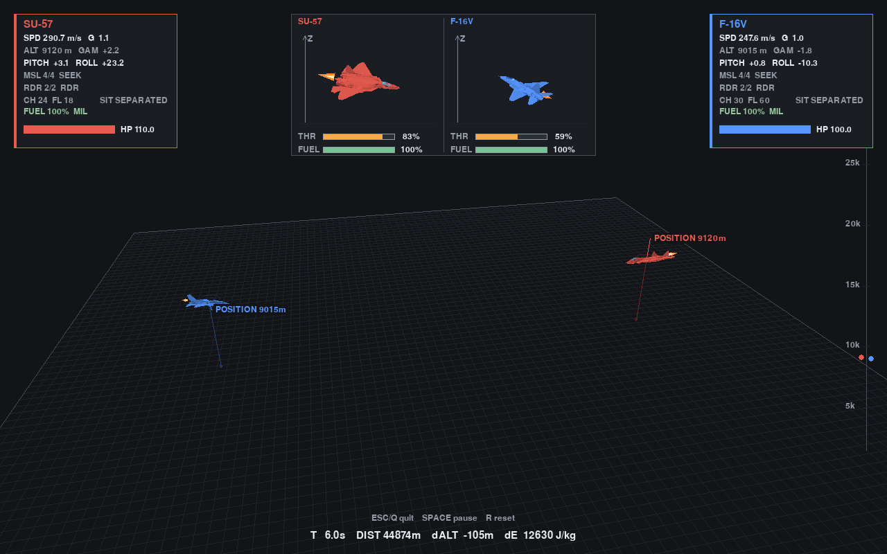
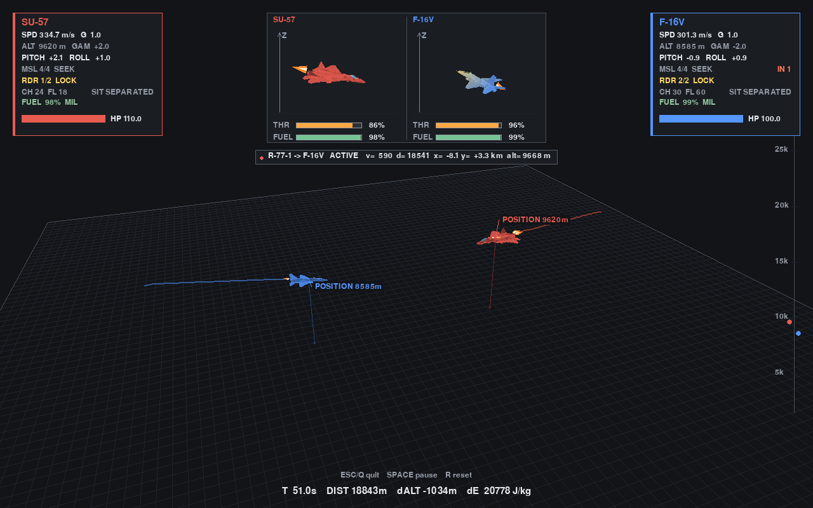
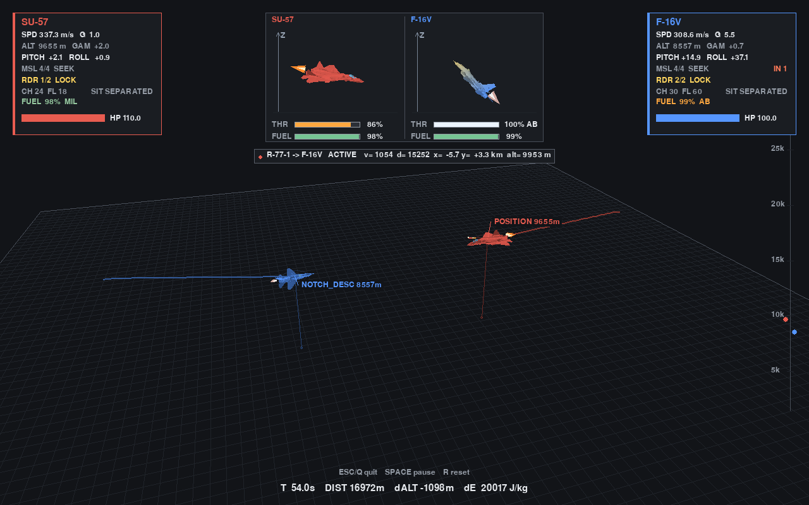
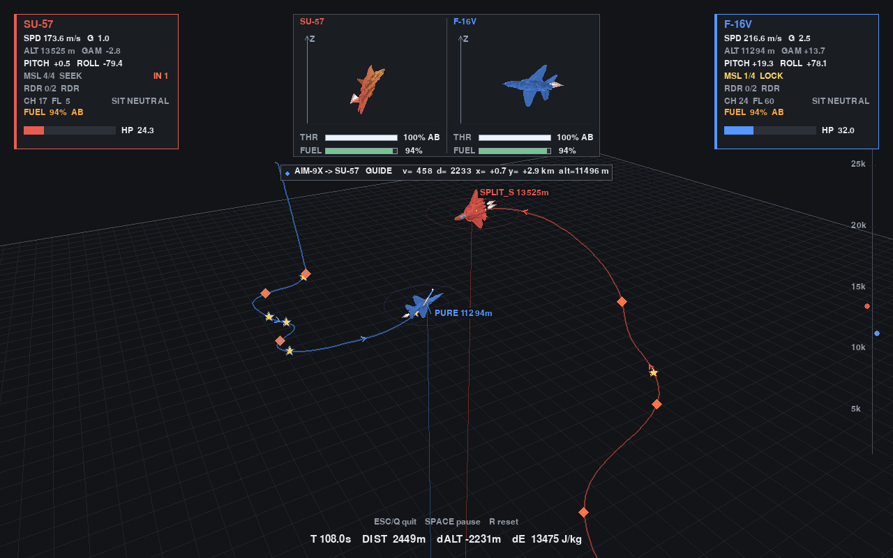
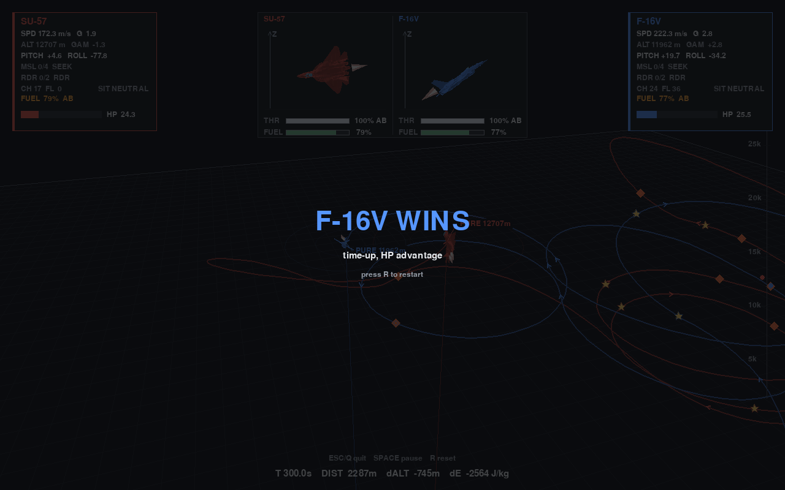
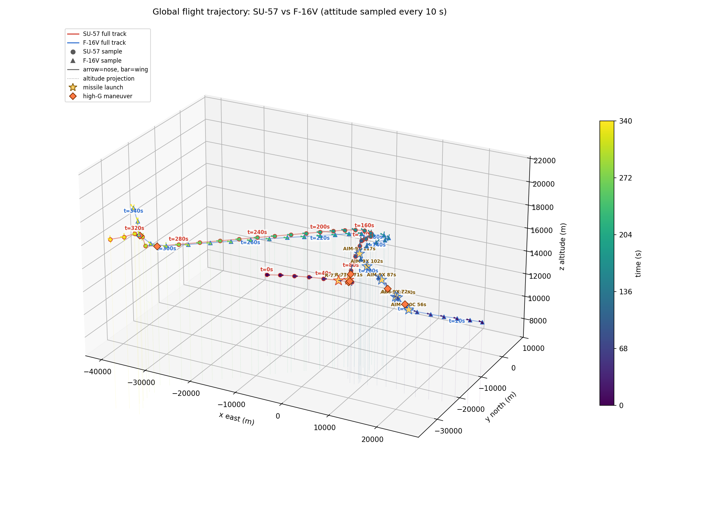

# 空战狗斗模拟器

基于 Python 的 1v1 空战对抗模拟：6DOF / 3DOF / 2DOF 动力学内核 + 四层战术 Agent + 透视 3D 可视化。
目标是研究**机体性能参数如何影响超视距（BVR）与近距格斗（WVR）的战术选择**，而不是做一个飞行模拟器。



## 功能

### 动力学内核

- 默认 6DOF 刚体，可一键切到 3DOF / 2DOF 做对照实验；物理步进 120 Hz，Agent 决策 10 Hz。
- ISA 标准大气（0–32 km），密度同时作用于升力、诱导阻力与推力；推力随高度按 `(ρ/ρ₀)^0.7` 衰减并叠加冲压恢复，阻力含跨声速波阻，速度由推力/阻力平衡自然决定。
- 军推 / 加力两档推力，对应不同单位耗油率（加力约为军推的 3 倍）；油量不足按剩余燃油等比降推，油尽禁止加力。开局速度取机型巡航马赫并反解巡航油门。
- 质量实时联动：导弹发射后推力、翼载、失速速度、比剩余功率、可用过载、转动惯量都按当前质量重算。
- Su-57 的 3D 矢量喷口（6DOF 专属）：除过失速操纵与 COBRA 外，喷流还带来随油门/加力开度缩放的等效增升（CL +0.30），把盘旋可用升力上限从 CL≈1.50 抬到 ≈1.80，低速段最小回旋半径明显小于常规喷口机型。
- 能量-高度联合约束：爬升角受 Ps 限制、过载上限随当地失速速度调整、能量天花板触发强制卸载。
- 飞行员过载耐受模型：持续 6 g / 峰值 9 g，疲劳累积到阈值触发 G-LOC 失能。

### 感知层（传感器与接触等级）

- 接触质量分四级：`CONTACT_NONE=0` 无接触、`CONTACT_DETECT=1` 仅探测/告警（只有方位、没有距离）、`CONTACT_TRACK=2` 稳定跟踪（有距离与角度）、`CONTACT_FIRE=3` 火控级（只有本机机头雷达开机照射才能给出）。
- 分向 RCS：Su-57 前 0.3 / 侧 1.2 / 后 2.5 m²，F-16V 前 1.2 / 侧 3.0 / 后 2.0 m²。目标机头方位 60° 内取前向值、120° 外取后向值，中间线性过渡，避免方位抖动导致探测距离跳变。
- 机头雷达探测距离 = `radar_range × RCS^0.25 × 多普勒可见度`：Su-57 160 km@1 m²、F-16V 70 km@1 m²；火控锥取 SARH 照射锥，探测锥 ±90°。
- Su-57 侧阵相对机头 ±35°–145°，探测距离为主阵的 0.55 倍，只给 `TRACK`；L 波段襟翼雷达 ±45°、200 km，只给 `DETECT`。
- IRST：Su-57 60 km（±30°，目标开加力时 ×1.5）；F-16V 无内置 IRST，靠 Legion 级光电吊舱被动跟踪 45 km。两者都只给 `TRACK`。
- 目视 tally：迎头/尾后 9 km、侧向 11 km，全向且不受 RCS 影响；没有 tally 时机炮仍可开火，但只允许 600 m 内、散布 ×2.5。
- 预警机 400 km@1 m²（按 RCS 缩放，设计口径 10 s 更新一次），只给 `TRACK`、不能当火控；RWR 只在本机落入对方机头雷达火控锥时告警，只给方位、没有距离。
- 火控门槛：中距弹要求雷达开机且 `CONTACT_FIRE`。静默（雷达关机）或只有 IRST/吊舱/预警机/侧阵的 `TRACK` 时，都拿不到火控诸元，不能发射雷达弹。

### 战术 Agent

- 四层架构：几何态势判定 → 战术族选择 → 机动原语执行 → 控制层（能量/过载/发射门限），所有原语最终都落到滚转角 + 过载指令上。
- 30 种机动原语：纯追踪、提前量追逐、滞后追逐、急转、破 S、防御滚筒、剪刀、内筋斗、殷麦曼、高/低悠悠、脱离、卸载、改出、规避、占位、CRANK、三九下高、F-pole、机炮提前量/压近、COBRA，以及一串高 G 变体。
- 开局按机体特性选择单环 / 双环抢位（瞬时转弯好的走单环、持续盘旋好的走双环），占位参数每次启动随机化。
- 开局为 120 km 对头接近（双方各距空域中心 60 km）；没有稳定跟踪时进入 `SEARCH`，朝最后已知位置或空域中心搜索，中距弹交完后由 `PRESS` 主动压近，油量/弹药见底则 `DISENGAGE` 脱离。
- 中距弹发射门限：首发必须进入不可逃逸区（NEZ）；已有一发在飞且首发属于低概率的边界射击（`radar_pk_est < 0.80`）时，冷却 3 s 后补射第二发，最多两发同时在空中。
- 防御动作按来袭弹剩余飞行时间分档，同一威胁内保持转向侧不抖动；箔条只在载机处于横转/三九姿态时才投放。

### 武器与对抗

- 主动雷达中距弹 R-77-1 / AIM-120C：中制导依赖载机雷达照射，末段导引头自主截获（pitbull）后发射后不管；远距发射自动 loft 弹道。
- 近距弹 R-73 / AIM-9X 与机炮，锁定采用"持续留在导引头视场内累计时长"的状态机。
- 导弹横向过载指令经一阶自动驾驶仪滞后（近距弹 0.12 s、中距弹 0.18 s）建立，末段目标拉大过载会产生真实脱靶。
- 近炸引信改为概率杀伤：按脱靶量与杀伤半径给出 PK 并掷骰，允许近失而非一发必杀。
- 雷达隐身：分向 RCS 按四次方根缩放探测、锁定、主动截获距离与发射包线；三九横穿落进多普勒盲区时，雷达与弹载导引头都会短暂失锁。
- 制导容错：中制导失照后按惯导外推，连续超过 2 s 才转无控；末段主动导引头连续盲区 > 2 s、连续越出视场 > 1 s 才真丢锁，恢复后重新接上比例导引。
- 双发齐射：首发进入 NEZ 才射；若首发是低概率边界射击且已有 1 发在飞，冷却 3 s 后补射第二发，最多 2 发同时在空中。
- 干扰物：Su-57 为 24 箔条 + 18 热诱弹，F-16V 为 30 箔条 + 60 热诱弹，具备独立运动、诱骗与渲染逻辑。

### 可视化

- 渲染优先走 OpenGL（moderngl），无可用 GL 上下文时自动回退 pygame 软件渲染，`--no-gpu` 可强制软件路径。
- 轨道相机自动跟随两机中点，可切换机尾跟拍；地面网格 + 高度投影线给出空间参照。
- HUD 包含双方状态框、三维姿态框（含油门条、燃油、来袭方向）、在飞导弹信息、剩余弹量与锁定进度、高度尺与结算画面。
- 实时轨迹带方向箭头，并标注机炮开火点、导弹发射点（金色星标）、高 G 机动点（橙色菱形）；发动机尾焰随推力变化。

### 实验工具

| 命令 | 说明 |
| --- | --- |
| `--headless` | 无窗口跑一局并打印过程与结果 |
| `--dof {2,3,6}` | 切换动力学内核（默认 6） |
| `--ab` | 同一套 Agent 在 3DOF / 6DOF 下的 A/B 对比 |
| `--ab-suite` | 跨内核 × 跨站位 × 多初始偏移的 12 局镜像矩阵 |
| `--record PATH` | 无窗口渲染并录制 mp4，同时输出全局轨迹图 |
| `--follow N` | 录制时跟随的飞机索引 |
| `--seed N` | 固定开局随机占位，复现实验用 |
| `--f16-radar {always,silent,auto}` | F-16V 雷达策略：常开 / 全程静默 / 静默+40 km 迎头短时开机 |
| `--su57-radar {always,silent,auto}` | Su-57 雷达策略，取值同上 |
| `--compare-radar` | 固定 seed=3，F-16V 三种雷达策略各跑一局并对比辐射后果 |
| `--awacs / --no-awacs` | 预警机开关，默认开启 |

## 截图

| | |
| --- | --- |
|  |  |
| 超视距阶段 18 km 迎头互射中距弹，HUD 显示在飞导弹与锁定进度 | 转入横转下高（NOTCH_DESC）规避，油门到加力，姿态框同步显示来袭方向 |
|  |  |
| 近距格斗：轨迹上金色星标为导弹发射点、橙色菱形为高 G 机动点 | 对局结算，完整航迹与事件标记一并保留 |



每 10 s 采样的全局三维轨迹，颜色表示时间，箭头为机头朝向与翼展方向，附带全部导弹发射点与高 G 机动点。

## 仿真模拟结果

### 1. 矢量喷口的盘旋收益

测得条件：9 km、Su-57 作战重量 25300 kg、定高定速、坡度上限 80°、过载取当地可用值（升力上限与 9 g 结构限制取小），用水平航迹弧长/转角反算半径 `R = V / ψ̇`。

| V (m/s) | 有矢量 R (m) | 无矢量 R (m) | 半径变化 |
| --- | --- | --- | --- |
| 130 | 789 | 972 | −18.8% |
| 150 | 763 | 916 | −16.7% |
| 180 | 748 | 880 | −15.0% |
| 200 | 742 | 865 | −14.2% |
| 210 | 763 | 863 | −11.6% |
| 220 | 857 | 861 | −0.5% |
| 250 | 1153 | 1153 | 0 |
| 300 | 1721 | 1721 | 0 |

- 最小回旋半径 **742 m（有矢量）/ 861 m（无矢量）**，约小 14%；角点速度附近的绝对最小半径出现在 200–210 m/s。
- 220 m/s 以上两者完全重合一档：此时可用过载已经撞上 80° 坡度对应的 5.76 g 上限，矢量增升再多也换不出额外的水平转弯率。矢量推进的收益因此集中**低速、大迎角**段，与真实喷流增升的作用区间一致。
- 参数取 CL 增量 0.30；敏感性扫描显示 0.15 / 0.30 / 0.45 分别对应最小半径 828 / 742 / 667 m，0.30 是“收益明显但不破坏能量平衡”的折中。

### 2. 无头对局回归

| 实验 | 结果 |
| --- | --- |
| `--headless --seconds 300`（6DOF） | 双方各射 4 发中距弹、各命中 1 发；300 s 超时按血量判 SU-57 胜（48.7% vs 4.3%）。max g = 7.4，高度 6.3–14.8 km，无越界/解体 |
| `--ab-suite --seconds 150`（12 局） | 3DOF：SU-57 5 胜 1 平（6 局全部击落）；6DOF：SU-57 2 胜 / F-16V 4 胜（4 局超时、2 局击落） |
| 矢量增升开/关对照（6DOF，5 seed × 2 站位） | 开：SU-57 5 胜 4 负 1 平；关：SU-57 5 胜 4 负 1 平 |

6DOF 下胜负基本由超视距导弹交换与开局几何决定，矢量增升不改变宏观胜率分布（10 局对照完全一致）；它的价值体现在进入近距后的瞬时转弯与抢角速度，而不是在导弹对射阶段。

### 3. 感知层与制导修复对照

在同一套 16 seeds × 200 s 实验下，对比“旧制导 + 单发”与“新制导 + 双发”两种配置（初始条件均为 120 km、Su-57 M1.30 / F-16V M0.95）：

| 指标 | A：旧制导 + 单发 | B：新制导 + 双发 |
| --- | --- | --- |
| 中距弹发射（SU57 / F16） | 32 / 25 | 32 / 12 |
| 中距弹命中（SU57 / F16） | 0 / 0 | 2 / 0 |
| 累计伤害（SU57 / F16） | 0 / 0 | 117 / 0 |
| 脱靶量范围 | 0.5–2.6 km | 8–143 m |
| 击落数 | 0 | 0 |

- 制导修复把中距弹从“几乎必然脱靶”压到百米级：失锁容忍与惯导外推让弹在目标短暂横穿后还能重新接上，脱靶量从公里级降到 8–143 m。
- B 组两发命中分别出现在 seed11（56 伤害）与 seed16（62 伤害），仍未形成击落：近炸概率杀伤按脱靶量衰减后，单发伤害低于 Su-57 110 HP / F-16V 100 HP 的机体血量。
- 双发齐射没有增加发射总数（A 组 32 发对应 B 组 32 发），只改变了发射节奏与在飞弹数量；F-16V 发射数从 25 降到 12，说明在 NEZ 门限下它更少做无效远射。
- 回归测试 42 passed；`test_w06_envelope_rcs_handling` 的假目标已改为真实 `Aircraft`，按分向 RCS 重新标定断言。

## 快速开始

需要 Python 3.10+（开发环境为 conda 环境 `dogfight`）。

```bash
conda create -n dogfight python=3.10 -y
conda activate dogfight
pip install pygame numpy matplotlib imageio moderngl

python main.py                      # 窗口观战（默认 6DOF、300 s）
python main.py --headless --seconds 300
python main.py --record out/match.mp4 --follow 0
python main.py --ab-suite --seconds 150
```

窗口模式操作：`ESC` 退出、`SPACE` 暂停、`R` 重置。

## 目录结构

```
sim.py      动力学内核、裁判、导弹/干扰物/命中判定
agents.py   几何态势判定 + 战术族/机动原语/控制层
render.py   透视 3D 渲染、HUD、轨迹与特效
main.py     入口、参数表、无头/录制/矩阵实验工具
docs/       进度文档与 README 截图
```

## 模型资源

机体模型与贴图体积较大（约 120 MB），未纳入版本库，需要自备：

- `I154-SU-57战机/I154-SU-57战机_OBJ.obj`（含 mtl 与贴图）
- `f_16c_model/f_16c.obj`（含贴图）

缺失时 `render.py` 无法加载模型，窗口与录制模式会报错；`--headless` 不依赖渲染，可直接运行。

## 参数来源

机体与导弹参数按公开资料取量级值（半油 + 中距弹的作战重量）：

| | Su-57 | F-16V Block 70 |
| --- | --- | --- |
| 机翼面积 | 78.8 m² | 27.87 m² |
| 推力（军推 / 加力） | 186 / 284 kN | 76.3 / 129 kN |
| 巡航马赫 | 1.30（不开加力超巡） | 0.95 |
| 分向 RCS 前/侧/后 | 0.3 / 1.2 / 2.5 m² | 1.2 / 3.0 / 2.0 m² |
| 机头雷达 | 160 km@1 m²（侧阵 + L 波段） | 70 km@1 m²（+ 光电吊舱） |
| 中距弹 | 2 × R-77-1（190 kg） | 2 × AIM-120C（152 kg） |
| 近距弹 | 4 × R-73 | 4 × AIM-9X |

F-16V 的重量与阻力计入 Legion 级光电吊舱：空重 +250 kg、`ΔCd0≈0.002`（0.039→0.041），吊舱挂机腹中线、不占武器挂架，6 枚弹挂载不变；它提供 45 km 被动 IRST 跟踪，但雷达弹仍必须靠机头雷达开机取得火控级接触。

模型为工程近似，用于比较战术与参数趋势，不可用于作战评估。
