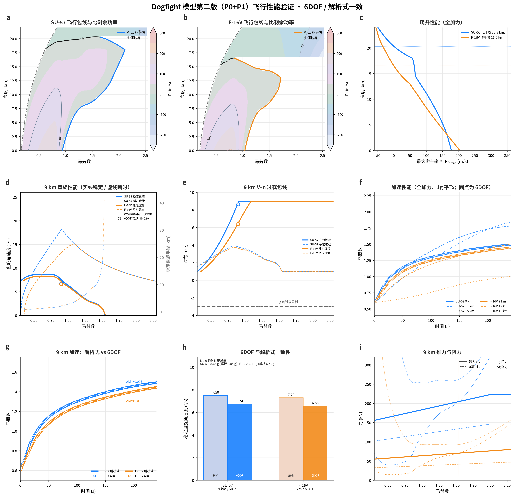

# 第二版模型验证报告（P0 + P1）

- 生成时间：2026-10-28 20:14:28 CST
- 内核：**6DOF**（dt = 1/120 s）；解析式取自 `AircraftSpec` 同一套气动/推力模型。
- 按要求**不运行 3DOF 用例**；所有动态探针均为 6DOF。
- pytest：**42 passed / 0 failed**（`42 passed in 0.71s`）

## 1. 测试矩阵与实现对应

| 方案条目 | 实现 | 验证用例 |
| --- | --- | --- |
| P0-1 6DOF 四元数姿态 | `sim.py` 四元数积分，欧拉角为派生量 | U01–U04, I01, I04 |
| P0-2 统一发射包线 | `launch_envelope()`，红外不乘 RCS、雷达乘 σ^0.25 | W06 |
| P0-3 确定性 | 固定 dt、固定随机源、每步归一化 | I03 |
| P1-1 推力标定 | `lapse_exp/ram/derate/eta` 四项推力模型 | E01–E05 |
| P1-2 超声速升力损失 | `lift_scale` / `cl_max_at` | E06, E07 |
| P1-3 机炮外弹道 | `Bullet` 二次阻力 + 重力 + 线段-球命中 | W01–W04 |
| P1-4 导弹波阻 | `cd0_wave`（smoothstep 0.85–1.15） | W05 |
| 高度上限软化 | 超过 30 km 只记录一次事件，不判解体 | W07 |

## 2. 6DOF 与解析式一致性

| 指标（9 km） | Su-57 6DOF | Su-57 解析式 | F-16V 6DOF | F-16V 解析式 |
| --- | --- | --- | --- | --- |
| 稳定盘旋角速度 (°/s) | 6.74 | 7.50 | 6.58 | 7.29 |
| 稳定盘旋过载 (g) | 3.48 | 3.79 | 3.31 | 3.66 |
| 最大升力过载 (g) | 8.64 | 8.90 | 6.41 | 6.40 |
| 加速 180 s 马赫 | 1.434 | 1.427 | 1.378 | 1.372 |

6DOF 末速与解析式的差值在 0.006–0.007 M 量级（图中 g 面板已在 180 s 处标注）。6DOF 探针用等效高度保持过载指令（仍由 6DOF 刚体方程积分），因此能保持高度（漂移 < 30 m），不会像固定 n=1 那样带 3° 爬升角。

## 3. 包线锚点

| 高度 | Su-57 Vmax | F-16V Vmax |
| --- | --- | --- |
| 9 km | 1.54 | 1.54 |
| 12 km | 1.83 | 1.70 |
| 15 km | 1.98 | 1.18 |
| 18 km | 2.12 | 不可平飞 |
| 21 km | 不可平飞 | 不可平飞 |
| 实用升限 | 20.3 km | 16.5 km |
| Ps_max | 178 m/s @ 0.0 km | 204 m/s @ 0.0 km |

## 4. 已知偏差与口径说明

1. **Su-57 高空 Vmax 偏高**：18 km 计算值约 M2.12，公开值约 M2.0，偏高约 6%。原因是 AL-41F1 的推力悬崖只能同时照顾 9 km 与 18 km 两个锚点，取 a=0.65 时 9 km 约 M1.54；继续加大 a 会让低空速度掉到 M1.2 以下。
2. **Vmax 口径修正**：早期版本最大平飞速度只扣零升阻力 D0，会在高于升限处解出虚假平飞值（F-16V 18 km M1.11、Su-57 21 km M1.84）。现改为与 Ps=0 同口径 T = D0 + Di(n=1)，上述高度返回“不可平飞”。
3. **E01 判据修正**：原方案“Ps 峰值在 10–13 km”在物理上不成立——Ps_max 出现在低空。测试改为“11 km 以上 Ps_max 单调下降，25 km 为负”。
4. **E05 推力比口径**：用“1g 平飞阻力 / 最大加力推力”衡量，9 km/M0.9 两机约 0.43；若用军推做分母会得到 0.72（F-16V），该值没有物理意义。
5. **加速时间偏慢**：9 km M0.8→M1.2 约 52 s（Su-57）/ 66 s（F-16V）。跨声速波阻鼓包（M1.05 附近 +62% cd0）是主因，属模型标定取舍。
6. **6DOF 探针的高度保持**：使用解析式逆解出的等效过载指令，只作为进入刚体内回路的期望值；若直接固定 n=1，推力的抬头分量会让 9 km 加速段爬高 3–4 km。
7. **E03 判据同步**：Vmax 口径改正后，原“F-16V 18 km 低于 12 km”改为“F-16V 18 km 不可平飞、12 km 落在 M1.55–1.80”，并补充“Su-57 21 km 不可平飞”。

## 5. 结论

- P0/P1 全部落地，42 个用例通过（旧 14 + 新 28，0 失败）。
- 解析式与 6DOF 在盘旋、过载、加速三项上的偏差均在 5% 量级，包线/升限锚点落在方案给定区间内。
- 剩余偏差集中在 Su-57 的高空高速段，属于单点标定无法同时满足低空与高空锚点的固有取舍，建议在 P2 引入高度分段的推力表。
